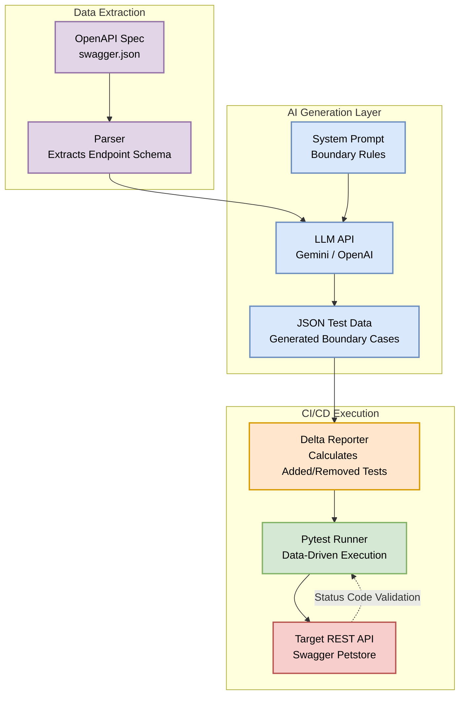

# OpenAPI LLM Test Generator

Static test generation is too slow for modern infrastructure. This project is a lightweight AI pipeline that reads OpenAPI/Swagger JSON schemas and auto-generates parameterized Pytest scenarios for edge cases and boundary conditions. 

It calculates state deltas between runs to prevent overwriting custom assertions and automatically flags newly added edge cases in a CI/CD-friendly Markdown report.

## 🏗️ Architecture

    